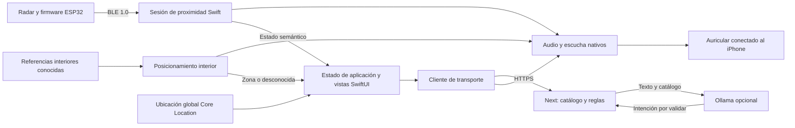

# Arquitectura de iPhone y experimentos para ExpoAndes

Fecha: **2026-11-02**, America/Bogota. Feria: **2026-11-17**. Estado: **recomendación de arquitectura y plan de trabajo; ninguna implementación ni prueba física realizada en este documento**.

Equipo confirmado: dos personas de aplicación, tres de hardware; Mac/Xcode e iPhone reciente disponibles, sin hardware comprado. Modelo exacto, versión de iOS/Xcode, experiencia en Swift y horas diarias disponibles todavía deben registrarse. La estimación siguiente usa disponibilidad explícita como supuesto, no como compromiso del equipo.

Este documento continúa [auditoría de código](auditoria-codigo.md) e [investigación de hardware e iOS](investigacion-hardware-ios.md). No repite sus hallazgos ni modifica producto, infraestructura, Windows, `CONTEXT.md` o GitHub. Los identificadores de tareas son propuestas para convertir en issues, no issues creados.

Se aplicaron `domain-modeling`, `architect`, `codebase-design` y la planificación de `prototype`: vocabulario, trazado, dos estructuras alternativas, interfaces pequeñas y preguntas comprobables. Se leyeron `how`, `why` y referencias pertinentes. No existe skill `arena` en las disponibles; no se ejecutó arena, comparación entre modelos, delegación, prototipo HTML, aplicación Swift ni rama desechable. La autorización actual cubre investigación y planificación; implementación y captura posterior de prototipos quedan descritas como trabajo futuro.

## Decisión recomendada

**Recomendar cliente SwiftUI mínimo para sesión local de sensores y una consulta textual de transporte, manteniendo Next.js como backend y conservando la web existente. No emprender una reescritura completa antes del 17 de noviembre.** La decisión se confirma con una prueba desechable, instalada en iPhone, antes de terminar el 4 de noviembre. Si falla, reducir integración presentada y registrar objetivos pendientes; no consumir la segunda semana cambiando de plataforma.

La recomendación cambia el orden de evaluación de la sección 6 del informe de hardware, que proponía comenzar por Capacitor. No contradice sus capacidades técnicas: incorpora el coste del cliente empaquetado observado en código y el calendario conocido. SwiftUI mínimo también reduce la paridad de interfaz propuesta en la auditoría; no se promete portar mapa, lupa, favoritas ni todos los modos de septiembre.

Los tres objetivos físicos permanecen separados: proximidad de obstáculos estáticos, personas/objetivos móviles y posicionamiento interior. Una pantalla, un radar o una simulación aprobados no cierran los otros. Este plan prevé una demostración de banco en primer plano y una zona interior simulada y autorizada. Fondo, uso corporal y movilidad en calle requieren puertas adicionales del informe de hardware.

## ADR: sesión local nativa, transporte centralizado y alcance pequeño

**Estado: propuesto; condicionado a X1 y X2.** El iPhone posee enlace BLE, validez de mediciones y salida de audio; Next posee datos y reglas de transporte. Elegimos SwiftUI mínimo porque ambas alternativas requieren núcleo Swift para BLE/audio, pero reutilizar la interfaz actual añade extracción estática de Next y adaptación de voz. Aceptamos menor paridad visual a cambio de una única ejecución local verificable; conservamos reglas TypeScript en servidor para evitar duplicarlas en Swift.

### Base de código y restricciones que explican la decisión

El recorrido existente es interacción web → `hooks/use-speech.ts` o texto → `components/total-agent.tsx` → `POST /api/agent` → catálogo normalizado y `runIntent` → JSON validado → voz y navegación. `GET /api/transmilenio` entrega catálogo. El respaldo de reglas del navegador requiere datos previamente cargados; no demuestra arranque sin red. La historia y documentación examinadas en los informes muestran que la inferencia geométrica de paradas era conocida; no prueban que se validara como instrucción de abordaje segura. No se atribuyen otras motivaciones a los autores.

| Evidencia local leída | Efecto sobre alcance |
| --- | --- |
| `package.json`, `next.config.mjs` | Next 16.3.3/React 19; sin dependencia Capacitor ni exportación estática configurada. No existe cliente móvil empaquetado reutilizable tal cual. |
| `hooks/use-transmilenio.ts`, `components/total-agent.tsx`, `components/diagnostics.tsx` | Peticiones relativas a `/api/*`; una interfaz local necesita origen HTTPS explícito. Un paquete estático no incluye ejecución de endpoints Next. |
| `hooks/use-speech.ts` y sus consumidores | Ocho módulos de interfaz usan síntesis web mediante el hook; el diagnóstico añade un noveno emisor directo. Asistente y diálogo usan reconocimiento web. Embutirlos sin adaptación deja varios emisores fuera del arbitraje nativo. |
| `lib/local-agent.ts`, `lib/transmilenio.ts`, `lib/routes.ts` | Esquemas JSON, intérprete y resolución de transporte ya existen. Deben corregirse en un solo lugar los problemas de paradas/sentido; cambiar interfaz no los resuelve. |
| `proxy.ts`, `lib/access.ts` | HTTP Basic cuando hay clave configurada; sin clave permite acceso. Estado real del despliegue no revalidado. Cliente nuevo debe manejar 401, sin inferir autenticación obligatoria ni credenciales conocidas. |
| Auditoría, hallazgos 1–8 y 14 | Recomendación de viaje, GPS y voz presentan límites previos; la sesión de radar debe ser independiente para no heredarlos como garantía. |

**Preservar:** backend, validaciones, reglas deterministas, autenticación y fallback existentes; funcionamiento de web y su compilación. **Cambiar:** propiedad del audio en cliente iPhone, ciclo de vida de peticiones y estados de datos. **Evitar:** portar planificador a Swift, llevar bytes BLE a pantallas, cargar web remota como supuesto arranque local, añadir IA al aviso urgente. **Riesgo:** Swift nuevo y protocolo sin hardware; mitigación mediante cortes instalables y puertas tempranas, sin prometer paridad.

### Dos estructuras comparadas

| Criterio | A. React empaquetado + Capacitor + núcleo Swift | B. SwiftUI mínimo + núcleo Swift + backend Next |
| --- | --- | --- |
| Forma completa | Vistas React → puente de sesión → BLE/audio Swift; HTTP separado hacia Next. | Vistas SwiftUI → sesión Swift; cliente `URLSession` hacia Next. |
| Reutilización real | Vistas, estilos, parte de lógica cliente; requiere separar cliente estático del servidor. | Backend, catálogo, reglas y contrato. Vistas JSX/hooks/Leaflet no se portan. |
| Complejidad escondida | Un módulo profundo puede ocultar BLE/audio; puente solo expone acciones y estado semántico. | Mismo módulo profundo; no necesita puente entre JavaScript y Swift. |
| Complejidad todavía visible | Dos compilaciones, compatibilidad Capacitor/plugin, permisos WKWebView, transporte HTTP y migración de todos los emisores de voz del paquete. | Nuevas vistas y decodificación Swift; accesibilidad nativa y firma requieren pruebas. |
| Coste en este repositorio | Exportación no configurada; endpoints dinámicos impiden tratar repositorio entero como estático. Plugin BLE no demuestra audio/caducidad sin callbacks JavaScript. | Nueva interfaz pequeña. Dos tareas: sesión y consulta; web sigue ofreciendo funciones restantes como producto separado. |
| Calendario | Adecuada si conservar pantallas actuales es requisito fuerte y X1 demuestra extracción pequeña. | Preferida cuando se acepta pantalla nueva pequeña y prioridad es integración física. |

**Síntesis manual de diseño:** B es base recomendada, adoptando de A la misma interfaz de sesión pequeña y reutilización de backend. No se ejecutó síntesis de arena. A sigue siendo alternativa si X1 encuentra exportación sencilla y existe requisito explícito de reutilizar pantallas. No se permite mezclar ambos clientes dentro del mismo entregable para eludir la decisión.

Ni Safari/PWA con Web Bluetooth, ni reescritura total de SwiftUI, ni audio A2DP producido en ESP32 resuelven mejor este alcance. Las restricciones documentadas de WebKit, empaquetado Next y audio están sustentadas en las fuentes A1, A4–A15 y S1–S4 del informe de hardware. No se presentan nuevas consultas externas.

## Mapa de módulos y propiedad

Nombres siguientes son un boceto, no archivos existentes. Cada módulo concentra conocimiento que sus consumidores no deben repetir. No hace falta un repositorio genérico, bus de eventos o colección de plugins.



El enlace de Ollama representa interpretación solicitada por Next: el modelo devuelve intención al backend y nunca controla avisos o sensor. Las flechas de estado omiten retorno de acciones para conservar legibilidad.

| Módulo | Interfaz propuesta | Implementación y propiedad que oculta |
| --- | --- | --- |
| Sesión de proximidad | Iniciar con accesorio elegido; detener; observar estado. | Autorización BLE, identidad/vínculo, escaneo, conexión, contrato 1.0, reloj/secuencia, caducidad, reconexión e histéresis. Solicita señales al módulo de audio; nunca configura `AVAudioSession`. |
| Audio y escucha | Presentar aviso semántico; iniciar/cancelar escucha explícita; detener emisión; observar disponibilidad. | Único dueño de `AVAudioSession`, síntesis, señal local precargada, cola, prioridad, ruta, llamadas/Siri y captura. Sin copia de bytes BLE ni reglas de transporte. |
| Ubicación global | Solicitar medición mientras se usa; detener; observar posición con precisión, antigüedad y rumbo válido si existe. | Core Location, permisos y limpieza. No convierte coordenada de estación en acceso ni llegada confirmada. |
| Posicionamiento interior | Iniciar/detener para espacio conocido; observar zona y referencia vigentes o desconocida. | Referencias fijas y método elegido en EA-09 del informe de hardware. No deduce piso/coordenadas desde RSSI del radar; no tiene por qué usar mismo sensor que proximidad. |
| Cliente de transporte | Consultar texto con ubicación opcional; cancelar consulta vigente. | `URLSession`, HTTPS, autenticación, timeout, decodificación validada, errores y antigüedad de respuesta. Sin planificación de viajes local. |
| Estado de aplicación/vistas | Acciones de usuario y estado visible. | Navegación, consulta vigente, foco accesible y preferencias mínimas. No importa Core Bluetooth ni decide prioridades acústicas. |
| Transporte Next existente | Endpoints existentes con JSON validado. | Fuentes, normalización, reglas/planificación y modelo opcional. No recibe muestras de radar ni procesa audio ambiente. |

La interfaz de sesión aporta profundidad: las vistas aprenden tres operaciones en lugar de coordinar permisos, tiempos y callbacks. Audio tiene profundidad propia porque concurren avisos de transporte, proximidad y escucha; sus decisiones no deben aparecer en cada pantalla. BLE simulado y real son variaciones necesarias para decidir antes de recibir placas; no justifican un framework de adaptadores genéricos.

### Uso primero y tipos después

Boceto de interacción, no código compilado ni nombres de métodos presentes:

```text
Usuario pulsa «Iniciar sesión» → sesión.iniciar(accesorio elegido).
Vista observa estado: «Conectando» → «Sensor activo, sin detección».
Sesión recibe dato vigente → audio.presentar(proximidad relativa).
Usuario escribe «horario B23» → cliente.consultar(texto, sin ubicación).
Respuesta de petición vigente → vista muestra; audio ofrece lectura opcional.
Usuario pulsa «Detener sesión» → sesión.detener(); descarta medidas y avisos propios.
```

```text
EstadoProximidad = desactivada | sinPermiso | bluetoothApagado | conectando
                  | incompatible | sinDatos(motivo)
                  | disponibleSinDetección(perfil)
                  | mediciónVigente(distanciaMM, sectorOpcional, perfil)

DisponibilidadAudio = disponible(ruta) | interrumpido | salidaSinConfirmar
                      | sinSalidaComprobada
ModoEscucha = inactiva | capturando | procesando | noDisponible(motivo)
UbicaciónGlobal = latitud + longitud + precisiónMetros + fechaMedición
PosiciónInterior = desconocida(motivo) | zona(referencia, fecha, alcanceDeclarado)
AvisoLocal = tipo + origen + instanteMonotónico + caducidad + contenidoSemántico
```

Estas dimensiones se observan juntas sin crear un caso por cada combinación: un sensor puede estar activo con audio interrumpido. Identificador de arranque, UUID GATT, secuencia y banderas pertenecen a implementación de sesión, nunca a `EstadoProximidad` público.

### Invariantes que deben quedar comprobables

1. **Independencia:** proximidad funciona desde arranque local sin Wi-Fi, datos móviles, GPS, backend, modelo ni permiso de micrófono. No implica transporte completo sin conexión.
2. **Validez:** solo mediciones compatibles, autenticadas según enlace realmente logrado y vigentes pueden producir aviso físico. Trama de simulación se anuncia como simulación y no activa sesión de uso real. Batería desconocida permanece desconocida.
3. **Tiempo:** referencia de reloj y edad siguen BLE 1.0 del informe de hardware, sin restar relojes de equipos directamente. Al reconectar/reanudar se invalida estado previo. Un temporizador no puede garantizar aviso de fallo mientras iOS impide ejecutar código.
4. **Semántica:** «sin detección», «sin datos», «fallo», «proximidad» y «zona desconocida» son distintos. Sin ángulo válido no hay «al frente»; sin blanco no hay «camino libre».
5. **Referencias:** distancia/sector del radar son relativos al sensor montado; ubicación global tiene precisión/edad; zona interior requiere referencia identificada. No se convierten entre sí por compartir palabra «ubicación».
6. **Propiedad acústica:** ningún otro módulo configura sesión de audio o llama síntesis directamente. El iPhone produce todo sonido hacia su auricular; ESP32 manda datos, no audio.
7. **Consulta vigente:** respuesta cancelada, vencida o de pantalla abandonada no habla ni navega. Desconexión de auricular no reproduce automáticamente información por altavoz público.
8. **Transporte verificable:** proximidad a trazado no habilita abordaje. Sin paradas/sentido/vigencia comprobados se muestra información de recorrido con su límite, sin órdenes de subir/bajar ni viaje operativo.

## Política de voz, avisos y accesibilidad

Prioridad propuesta: señal de proximidad vigente y pérdida de capacidad de aviso → explicación breve de estado → lectura de transporte solicitada. La señal de fallo informa indisponibilidad, no distancia anterior. Deduplicar fallos persistentes y actualizar proximidad en vez de acumular frases. Umbrales/histéresis y máximo de señales siguen propuesta experimental de sección 7 del informe de hardware; no representan distancias seguras.

Durante escucha explícita, la primera señal de proximidad cancela captura, descarta audio parcial y presenta aviso; no reanuda micrófono automáticamente. Si la persona quiere seguir hablando, vuelve a pulsar. Una lectura de transporte interrumpida no se repite sola: acción «Repetir» solicita el contenido todavía válido. Descartar avisos vencidos tras llamada/Siri; confirmar ruta y recibir dato nuevo antes de anunciar medida. Este arbitraje necesita X2, no basta una prioridad numérica.

VoiceOver conserva control del usuario; no se trata como síntesis que la app pueda cancelar a voluntad. X2 debe comprobar que las señales se distinguen y no tapan etiquetas. Para texto ya leído por VoiceOver, lectura propia es opcional; evitar doble locución de todo cambio. Señal corta más frase breve a petición, junto con estado visual y háptica si está disponible. No usar color, sonido o gesto como único canal.

Interfaz mínima: pantalla de sesión con estado de sensor y audio, botón «Iniciar/Detener», selección de accesorio y acceso a explicación; pantalla de consulta con entrada de texto, «Enviar», «Cancelar» y respuesta. Permisos se solicitan cuando la acción los necesita. Dictado es mejora condicionada a soporte local y tiempo; texto mantiene consulta utilizable. Denegar micrófono o ubicación no bloquea BLE. Antes de usar backend se informa envío de texto y ubicación opcional.

Controles estándar, texto escalable, contraste y orden lógico. Objetivo de interacción táctil iOS: al menos 44 × 44 puntos. Al abrir resultado, foco en título/respuesta; al volver, foco en control que lo abrió. Fallo importante se anuncia una vez sin robar foco continuamente. Lista y texto contienen información esencial; no se exige mapa para entender estado o consulta. Estos son criterios de diseño por comprobar con VoiceOver, no una declaración de accesibilidad alcanzada.

## Contrato backend y compatibilidad

**Conservar contrato actual para primera consulta; no crear endpoint nuevo solo para lanzar iOS.** El módulo concreto usa un único origen HTTPS configurado explícitamente. Credencial de demostración introducida por persona y guardada en Keychain si el servidor la requiere; no incluirla en binario, recursos web, URL o registros. No reenviar `Authorization` a otro origen durante redirección. No cambiar ahora autenticación o infraestructura.

| Operación existente | Datos actuales y validación mínima del cliente |
| --- | --- |
| `GET /api/transmilenio` | `stations`, `routes`, `fetchedAt`, `source: live/snapshot`, según `TransmilenioDataSchema`. Validar tipos, rangos y consistencia antes de usar; un catálogo vacío no activa planificación. Puede omitirse en cliente mínimo si solo presenta respuesta textual del agente. |
| `POST /api/agent` | JSON `{message, position?: {lat,lng}}`. Servidor acepta hasta 2.000 caracteres de cuerpo tras leerlo y recorta frase a 300; cliente limita entrada a 300 y no depende de recorte silencioso. Ubicación inválida se descarta hoy en backend. |
| Respuesta del agente | Base `reply`, `steps[{label,detail?}]`, `engine: reglas/ollama`; unión por `action`: `none/frequent/gps`, `search + station`, `route + routeCode`, `trip + trip[{routeCode,board,alight,stationsRidden}]`. No contiene prueba de parada verificada, caducidad de plan ni versión de catálogo. |
| Errores | 401 del proxy puede ser texto, no JSON; 413/429 del agente llevan respuesta estructurada y 429 incluye `Retry-After`; distinguir red caída, timeout, 5xx y JSON incompatible. Cero reintentos automáticos de POST. |
| `GET /api/agent` | Diagnóstico de motor; no es requisito para iniciar sesión BLE ni consulta textual. |

Propuesta de espera máxima de cliente: **12 s**, con cancelación al salir o pedir de nuevo y opción explícita de reintentar. Es criterio de UX por medir; no representa latencia actual. La cancelación local evita efectos tardíos aunque el servidor termine su cálculo. Petición no usa coordenada retenida indefinidamente: ubicación opcional conserva precisión/fecha internamente; propuesta inicial, solo adjuntarla si edad ≤ 30 s y precisión ≤ 50 m; si no, pedir origen escrito sin bloquear consulta. Estos umbrales no convierten posición en acceso verificado.

El cliente mínimo reconoce todas las variantes `action`, pero solo presenta funciones implementadas: texto siempre; ruta/viaje se presentan como información con límites, sin navegación automática a pantallas ausentes. Dado que `reply` actual puede contener órdenes de abordaje, **no basta ocultar `trip` en iOS**: T3 debe corregir generación de respuesta en `runIntent` y sus consumidores web. Hasta entonces, demostración nativa de transporte se limita a consultas no operativas comprobadas, como saludo y horario de servicio identificado; no se vende como guía de viaje.

Cambios futuros de paradas/procedencia deben mantener endpoints actuales para web; si cambia significado incompatible, requiere contrato/versionado propio y fixtures compartidos de JSON. No se prescribe una envoltura v2 genérica hoy. Un `POST /api/viajes` estructurado tendría sentido cuando se implemente selección de origen/destino; queda fuera del mínimo textual. No convertir selección estructurada en frase para volver a interpretarla.

**IA:** Ollama sigue interpretando en servidor, con intención validada y resolución por reglas/datos. No entra radar, aviso urgente, decisión acústica, reloj, identidad BLE ni localización interior al modelo. Sin modelo disponible, transporte usa respaldo de reglas existente; sin backend, cliente nativo informa indisponibilidad de consultas nuevas. No se promete copiar fallback TypeScript a Swift.

## Prototipos previstos: preguntas y resultados que faltan

No se construyeron ni ejecutaron estos prototipos. Se describen para que un issue pueda verificarse sin confundir maqueta con producto. Tras implementación autorizada, conservar fuente desechable y veredicto como evidencia enlazada al issue; no incorporar selector o simulador de desarrollo en sesión física.

| Prototipo | Pregunta y artefacto pequeño | Escenarios y decisión esperada |
| --- | --- | --- |
| P1, lógica | HTML único desechable, abierto con doble clic; estado en memoria, botones de eventos y recorridos guiados. ¿Distingue la persona estado del sensor de disponibilidad del audio? | Activar → dato válido → dato vencido; escuchar → proximidad; llamada → dato viejo → dato nuevo; quitar auricular; cambiar arranque; simulación. Mostrar estados completos con etiquetas comprensibles, no JSON crudo. Rechazar diseño si permite anunciar medida vencida o confunde «sin detección» con autorización de avanzar. |
| P2, interfaz | Tres jerarquías de misma tarea en prototipo local desechable: A estado y una acción principal; B lista de estados y acciones; C flujo guiado de preparación, sesión y cierre. | Misma información, distinto orden/estructura. Probar iniciar, reconocer fallo, cancelar y recuperar sin ayuda visual. Elegir según tareas con VoiceOver, no según color. Si se usa ruta web, selector por `?variant=A/B/C`, teclado y exclusión de producción; no demuestra accesibilidad SwiftUI. |
| P3, iPhone | App desechable firmada con una pantalla y emisor sintético dentro de proceso. ¿Llegan estados y sonido sin JavaScript/red y con ruta real? | Arranque frío sin red, permiso micrófono denegado, VoiceOver, auricular, llamada/interrupción y retorno. Inyección prueba política local; **no prueba BLE real, radar, latencia física ni autenticación**. |

P1/P2 son actividades breves de diseño; no obligan a construir tres interfaces de producción. P3 puede convertirse en el primer corte solo después de retirar inyección de datos de la sesión física y completar validaciones reales.

## Experimentos de decisión con límites

Presupuesto de exploración total: **máximo dos días-persona de aplicación**, ya incluidos en T1/T2. Parar al obtener evidencia decisiva o agotar límite. Resultados posibles: aprobado, fallido, pendiente; una puerta pendiente no cuenta como aprobada.

| Experimento | Límite y fecha de cierre | Evidencia y puerta |
| --- | --- | --- |
| X1: coste de plataforma | Hasta 1 día-persona combinado; cierre 4/11. Primero B: hasta 4 h para proyecto mínimo, firma/instalación y pantalla local. Inspección A hasta 4 h solo si requisito de reutilización de vistas o bloqueo concreto de B. | Registrar modelo/iOS, Xcode, firma y ejecución instalada. B aprobada si arranca local y muestra estado con VoiceOver. A requiere artefacto de interfaz local sin `server.url`, backend separado y estimación de alcance de voz; no modificar Next de producción para demostrarlo. Si ninguna pasa, no comprometer app integrada para feria. |
| X2: arbitraje acústico | Hasta 0,5 día-persona; antes del 5/11, con P3. | Tabla con VoiceOver, reproducción, captura si existe, auricular y llamada. Comprobar cancelación y ausencia de frases viejas; ruta inesperada impide emisión automática. Si falla dictado, mantener texto; si falla audio local, sesión no se presenta como aviso auditivo funcional. |
| X3: comprensión de estados | Hasta 0,5 día-persona; P1/P2, antes del 5/11. | Revisión interna y, si existe participante disponible, evaluación formativa separada y consentida. Cero mensajes equivalentes a «camino libre» o llegada no verificada. Revisión entre compañeros solo valida consistencia del diseño; no sustituye usuarios de H1. |

BLE físico, latencia acústica, autenticación, fondo y sensores son pruebas B1–B10/I1–I3/H1 del informe de hardware. No duplicar aquí el protocolo ni ensayos extensos. T2 y T5 los referencian y adjuntan resultados. Sin placas no se adelanta su aprobación usando inyección.

## Hasta seis tareas verticales para dos personas de aplicación

Prioridad de entrega: cortes instalables y demostrables. AP1 concentra Swift/BLE/audio; AP2 contrato/transporte, interfaz accesible y referencias interiores. Pueden ayudarse en revisión, sin inventar una tercera persona de aplicación. Estimaciones son **días-persona de trabajo concentrado**, no días calendario; incluyen comprobaciones del propio corte. Las cinco personas no son intercambiables: trabajo de hardware tiene dependencias externas separadas.

| Tarea propuesta | Resultado y aceptación de extremo a extremo | Dependencias y dueño | Estimación |
| --- | --- | --- | --- |
| T1. Instalar primera sesión local y fijar arquitectura | P3 instalado en iPhone; arranque sin red, estado separado sensor/audio, iniciar/detener y VoiceOver. X1–X3 registrados, simulación explícita. Elegir A o B y registrar alcance exacto. | Ninguna; Mac/iPhone disponibles y firma. AP1 + revisión AP2. | 1,5–2 días-persona. |
| T2. Recibir una medida BLE real y avisar sin red | Accesorio seleccionado → enlace → versión compatible → dato fresco → señal; al detener, reconectar, vencer dato o cambiar arranque no se reproduce medida vieja. Vectores BLE 1.0 compartidos y pruebas de longitud/rangos/orden/caducidad; banco real distingue perfil, sin blanco, fallo y batería desconocida. Medir B4–B6 y comprobar enlace B10 según alcance. | T1; hardware/firmware BLE 1.0 y alimentación aprobada de EA-02/03/05. AP1, coordinación con hardware. | 2–3 días-persona. |
| T3. Consultar transporte sin instrucciones no verificadas | Texto iPhone → HTTPS → respuesta → lectura solicitada; 401, 413, 429, timeout y cancelación recuperables; petición vieja no habla/navega. Corregir fuente compartida para impedir abordaje geométrico y sentido contradictorio; si no existe catálogo de paradas validado, informar recorrido sin instrucción operativa en backend/web. Fixtures JSON actuales decodifican en Swift; web conserva contrato. | T1; catálogo/fuente para habilitar viajes operativos. AP2. | 2–3 días-persona; integrar catálogo nuevo solo si cabe, de lo contrario aplicar restricción funcional explícita. |
| T4. Mostrar zona interior conocida o desconocida | Sesión en espacio simulado autorizado identifica zona desde referencia fija y la pierde al caducar; interfaz y voz explican alcance. Ensayo I1–I3 del método escogido; no mostrar coordenadas métricas sin evidencia. | T1; elección y referencias de EA-09, proporcionadas por hardware. AP2. | 1–2 días-persona para integración app, sin contar adquirir/instalar referencias. |
| T5. Ejecutar sesión completa accesible con fallos | Iniciar → medición → consulta → interrupción → recuperación → detener; VoiceOver, permiso denegado, desconexión de auricular, datos viejos y consulta cancelada. Una persona comprende estados sin depender de mapa/color; registrar fallos. B7/B8 definen fondo por combinación real; si falla, alcance primer plano. H1 solo con participantes/consentimiento reales. | T2, T3, T4; AP1/AP2 y coordinación con hardware. | 1,5–2 días-persona. |
| T6. Congelar y ensayar entrega reproducible | Versión instalada y registrada; guion corto con tres objetivos, prueba de fallo y resultados aprobados/fallidos/pendientes. Fuente/versión/fecha y limitaciones visibles. Repetir instalación/arranque previo a feria según firma efectiva; sin depender de tienda o renovación de firma supuesta. No llamar a emergencias en pruebas. | T5 o matriz explícita de objetivos no logrados; AP1/AP2. | 0,5–1 día-persona. |

**Total: 8,5–13 días-persona.** No incluye hardware, compras, aprendizaje extenso de Swift, reclutamiento ni portabilidad de toda la web. No es estimación de una reescritura. T2 puede avanzar con simulación durante espera, pero solo cierra con BLE real; T4 solo cierra con referencia física. T3 cierra como consulta informativa si falta fuente verificable; habilitar viaje operativo mantiene puerta pendiente.

Supuesto razonable para estudiantes: dos personas × 11 días activos × 4 h/día ≈ 88 h, equivalentes a 11 días-persona de 8 h. Reservar 20 % deja unas 70 h, **8,8 días-persona**: solo extremo bajo cabe y riesgo de calendario es alto. Con 2 h/día por persona, capacidad efectiva ronda 4,4 días-persona y plan completo no cabe. Con disponibilidad distinta, recalcular antes de comprometer alcance. Reducir pantallas/dictado/mapa no permite declarar aprobados objetivos físicos pendientes.

Calendario propuesto: 2–4/11 decisiones y firma; 4–8/11 T2/T3 en paralelo; 8–11/11 integrar T4 y cerrar datos; 12–14/11 T5; 15/11 T6 y congelación; 16/11 contingencia y ensayo; 17/11 exposición. Sábado/domingo cuentan solo si equipo confirma disponibilidad. Tareas son pequeñas por resultado, no por capa: ninguna se cierra únicamente al crear estructura Swift o escribir parser.

### Puertas de plazo y ruta crítica

- **4/11:** iPhone instalado, arquitectura elegida y salida local comprobada. Si no pasa, conservar web y presentar estado de investigación; no prometer otra arquitectura en última semana.
- **6/11:** sensor adecuado y transporte BLE en banco disponibles, o fecha de entrega verificable inmediata. Si no, la integración de T2 queda en riesgo crítico; simulación solo ensaya software. El grupo de hardware debe informar por separado obstáculo estático y objetivo móvil.
- **9/11:** al menos un recorrido físico real de datos y una referencia interior disponibles. Si alguno falta, registrar objetivo pendiente/fallido y cambiar guion de evidencia, sin inventar cumplimiento.
- **12/11:** no añadir pantallas, protocolos, sensor nuevo ni dictado; resolver fallos de cortes existentes. Fondo solo se incluye si B7/B8 pasan; no bloquea demostración declarada en primer plano.
- **15/11:** congelar artefacto probado y guardar procedimiento de arranque/recuperación. No depender de red, servidor o proceso externo para demostrar proximidad local.

Rutas críticas: compra/perfil de radar → firmware y BLE real → T2 → T5; referencias interiores → T4 → T5; firma/audio iPhone → T1 → T2. T3 puede avanzar en paralelo sin hardware. Si fuente de paradas no aparece, restringir transporte evita bloquear sensor y mantiene explícita la limitación del viaje operativo.

## Evidencia utilizada y límites

Evidencia directa de esta revisión: lectura de archivos citados, esquemas, consumidores de voz, endpoints y configuración. Evidencia externa heredada: fuentes primarias ya abiertas y fechadas en ambos informes, especialmente Apple Core Bluetooth/audio/Speech (A2–A15), Next exportación estática (S2), Capacitor (S1/S3/S4), posicionamiento interior (A16–A18) y fuentes de transporte de auditoría. No se agregaron enlaces externos nuevos ni se atribuye una nueva consulta a esas páginas.

Confianza alta en forma actual del código y ausencia de cliente iOS/configuración Capacitor en archivos examinados. Confianza media en preferencia de SwiftUI mínimo frente a extracción React; X1 decide coste efectivo. Estimaciones, UX, prioridades acústicas, métodos de zona y puertas son propuestas. Ausencia de hardware impide demostrar BLE, sensor, latencia, autonomía, exactitud, audio en iPhone, fondo o utilidad con personas.

Revisión documental realizada: contrastar uso y tipos propuestos, separar estados ortogonales, comprobar suma de estimaciones y que cada tarea tenga aceptación/dependencias. No se corrieron pruebas de aplicación ni compilación porque solo se redactó este documento. Reescritura completa, OCR, mapa nativo, dictado obligatorio, batería propia, posicionamiento métrico no demostrado y distribución pública quedan fuera del esfuerzo estimado; cualquier requisito adicional necesita recalcular capacidad y fecha.
