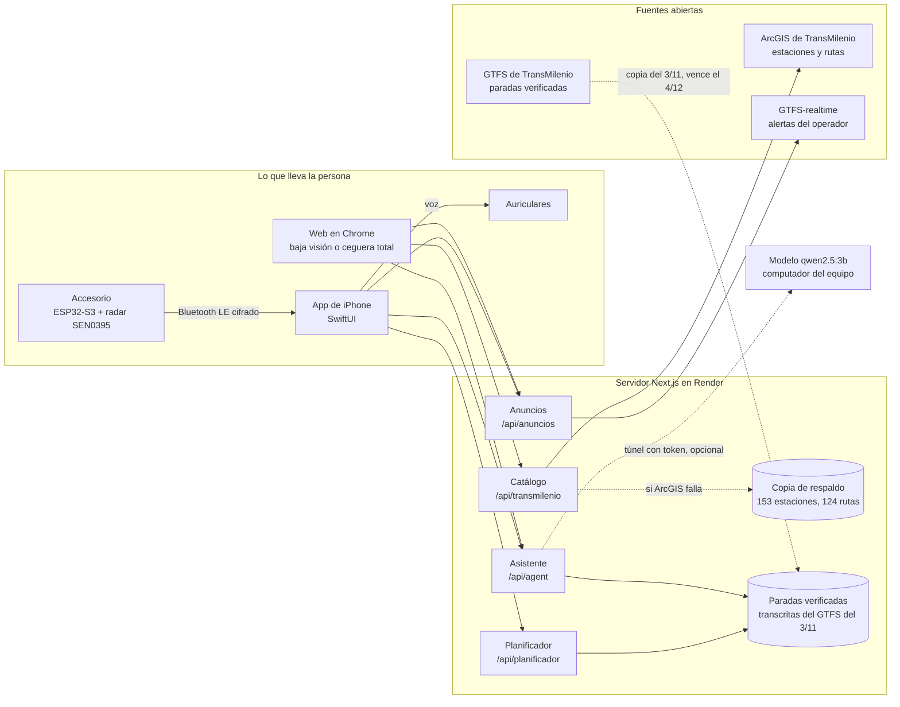
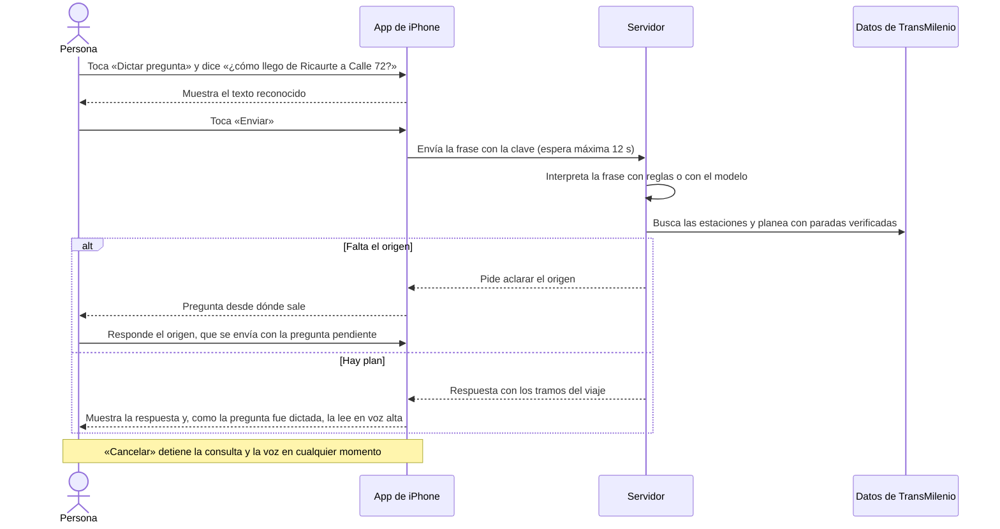
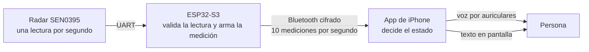

# 7. Diseño de la solución

**Criterio:** Diseño de solución, 15 puntos.
**Base:** Proyecto 1, páginas 9 a 11: dos wireframes y un diagrama.
**Qué cambia:**
- El diagrama del Proyecto 1 se titulaba «diagrama de flujo», pero era de arquitectura.
- Mostraba la API de Google Maps y «visión artificial», que no se construyeron. Aquí se reemplaza por la arquitectura real.
- Se agregan dos flujos de uso, el prototipo del iPhone y las decisiones de accesibilidad.

Los diagramas están en Mermaid, que GitHub dibuja. Para la versión en Word se exportan como imagen.

## 7.1 Wireframes del Proyecto 1

Se conservan como figuras.
- **Wireframe 1:** barra de búsqueda y accesos múltiples (rutas frecuentes, buscar rutas, asistencia), pensado para baja visión.
- **Wireframe 2:** interfaz mínima con dos botones grandes, voz y cámara.

La web final combinó las dos ideas en sus dos modos:
- **Baja visión:** cinco opciones grandes, como el wireframe 1.
- **Ceguera total:** toda la pantalla es un botón que escucha, como el wireframe 2 llevado al extremo.

## 7.2 Prototipo del iPhone (EA-02)

Antes de escribir la app se hizo un prototipo desechable con dos variantes ([evaluación y decisión](../prototipos/ea-02/evaluacion-y-decision.md)):

- **Variante A, «una acción principal»:** un inicio central del que salen todas las tareas.
- **Variante B, «pestañas y lista de estados»:** cinco pestañas (Inicio, Viajar, Asistente, Avisos, Más).

**Mediciones automáticas** en un navegador sin ventana, con pantalla de iPhone (390 × 844):
- 395 combinaciones de pantalla y estado.
- Todos los controles de al menos 44 × 44 puntos.
- Contraste mínimo de 17,31:1.
- 66 de 66 reglas de diseño cumplidas.
- En el recorrido de 10 tareas con lector de pantalla simulado, A necesitó 174 deslizamientos y 31 activaciones, y B 311 y 33. A fue más corta en las 10 tareas.

**Decisión.** La recomendación provisional era A. El 7/11, A2 eligió B por orden y estética, con cinco ajustes:
1. Barra de pestañas más grande.
2. Asistente destacado en la barra.
3. Avisos también dentro de «Más».
4. No poner todas las herramientas en una sola fila.
5. «Más» en cuadrícula.

**No hubo sesiones con usuarios** sobre el prototipo. Se aplazaron hasta tener la app instalada.

> **Por confirmar:** la app final tiene cinco pestañas distintas de las del prototipo: Sesión, Consulta, Avisos, Lupa y Ajustes. Hay que explicar por qué cambiaron. Una posibilidad es que la pestaña Sesión del accesorio se volviera central. Si el equipo no lo decidió, decirlo como diferencia entre prototipo y producto.

## 7.3 Arquitectura

| Parte | Qué hace | Qué no hace |
| --- | --- | --- |
| Web | Interfaz, voz del navegador, ubicación, cámara. | No tiene cuentas. Modo, contraste y favoritas se guardan solo en el navegador. |
| App de iPhone | Interfaz, dictado, voz, enlace con el accesorio, validez de las mediciones, avisos. | No calcula rutas: se las pide al servidor. No usa la ubicación. |
| Accesorio | Lee el radar, arma cada medición y la envía cifrada. | No habla ni decide avisos: eso lo hace el iPhone. |
| Servidor | Datos, reglas del asistente, planificador, anuncios, clave y límites de uso. | No guarda historial de preguntas. |
| Modelo | Clasifica la frase y extrae nombres. | No decide rutas ni horarios: el servidor valida todo contra los datos. |

Fuentes: [README](../../../README.md), [ios/README.md](../../../ios/README.md), [arquitectura](../arquitectura-y-experimentos.md), [contrato Bluetooth](../contrato-ble.md) y [nota de EA-05](../nota-ea05-paradas-sentido.md). Las paradas verificadas se transcribieron del GTFS publicado el 3/11 y la app deja de usarlas después de 31 días.

## 7.4 Flujo de uso: preguntar cómo llegar (iPhone)

En la web el flujo es el mismo. En el modo de ceguera total la persona toca cualquier parte de la pantalla para hablar, y la app abre el resultado sola.

## 7.5 Flujo de uso: aviso del accesorio

La app distingue estos estados y nunca anuncia «camino libre» ([puertas de hardware](../puertas-hardware.md), [CONTEXT.md](../../../CONTEXT.md)):

| Estado | Qué significa |
| --- | --- |
| Presencia | El radar reporta algo dentro de su ventana de 30 cm. |
| Sin detección | El radar no reporta nada dentro de sus capacidades. No demuestra que no haya obstáculos. |
| Dato vencido | La última medición tiene más de 500 ms. |
| Fallo del sensor | El radar no responde o la medición no es válida. |
| Desconectado | No hay enlace con el accesorio. |
| Audio no disponible | No hay auriculares, así que la app no habla por el altavoz. |

El radar entrega una lectura por segundo y la medición vence a los 500 ms. Por eso cerca de la mitad de las mediciones llegan vencidas. Es un conflicto conocido del contrato ([contrato Bluetooth](../contrato-ble.md), sección 7).

## 7.6 Decisiones de accesibilidad

**Web:**
- Tema claro «cabecera lima»: fondo blanco, cabecera lima, letra negra con contraste de al menos 7:1 y contornos gruesos.
- Tema oscuro de alto contraste.
- Todo se dice en voz alta en es-CO.

**iPhone:**
- **Texto y contraste:** el texto crece con el tamaño de letra del sistema. El texto secundario tiene contraste de al menos 4,5:1. El estado nunca depende solo del color.
- **VoiceOver:** los avisos urgentes se anuncian sin mover el foco. Con VoiceOver activo, la voz propia de la app empieza apagada para no hablar dos veces.
- **Audio:** la voz propia solo sale por auriculares, porque una medición del sensor dicha por el altavoz la oye todo el que esté cerca.
- **Mapa:** es solo una ayuda visual. La lista de la misma pantalla tiene la misma información.
- **Permisos:** una pantalla propia explica cada permiso antes de que iOS lo pida.
- **Pruebas:** la integración continua corre la auditoría automática de accesibilidad de Apple con texto normal y con el tamaño más grande ([CI de iOS](../ios-ci.md)).

## 7.7 Figuras para la versión en Word

> **Pendiente:**
> - Figuras 1 a 5: mapas de empatía, del Proyecto 1, con seudónimos.
> - Figuras 6 y 7: wireframes 1 y 2, del Proyecto 1.
> - Figura 8: las dos variantes del prototipo EA-02.
> - Figura 9: arquitectura (7.3).
> - Figuras 10 y 11: flujos de uso (7.4 y 7.5).
> - Figuras 12 en adelante: capturas de la web (inicio en los dos temas, asistente, plan de viaje, ruta, emergencia, Metro, avisos) y del iPhone (las cinco pestañas, rutas, viaje y lupa).
> - Una foto del accesorio armado.
